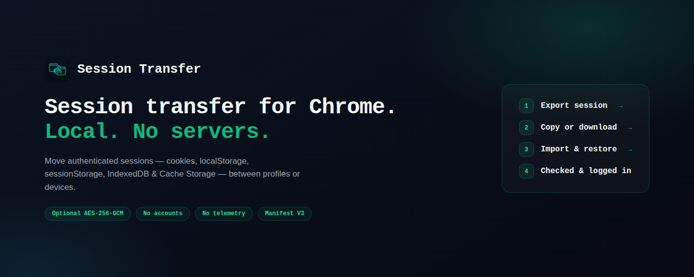
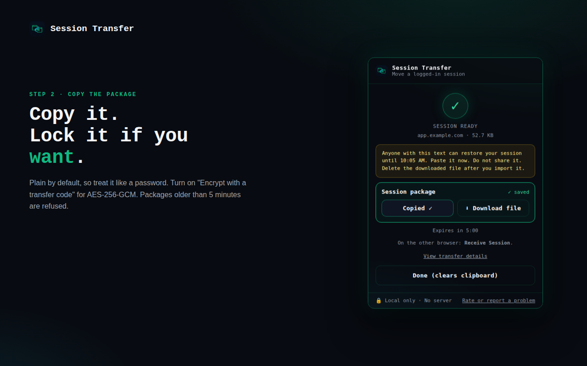
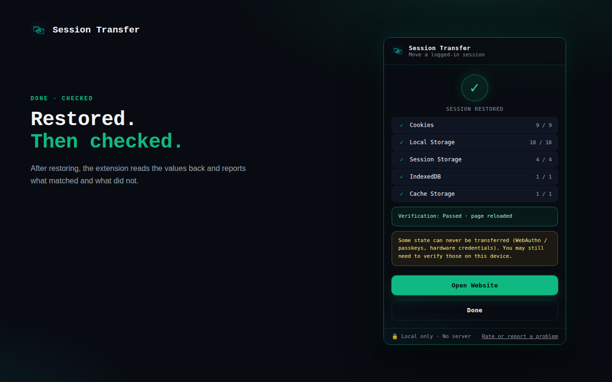

<p align="center">
  
</p>

<h1 align="center">Session Transfer</h1>

<p align="center">
  <strong>Move a logged-in website to another Chrome profile, browser or computer, without signing in again.</strong>
</p>

<p align="center">
  <a href="https://chromewebstore.google.com/detail/fnfmlchbfofjdfeibgdkcibfjjlfcefc"><strong>Add to Chrome</strong></a>
  ·
  <a href="https://ravitejakamalapuram.github.io/">Website</a>
  ·
  <a href="https://ravitejakamalapuram.github.io/session-transfer.html">Privacy policy</a>
  ·
  <a href="extension/docs/threat-model.md">Threat model</a>
  ·
  <a href="CHANGELOG.md">Changelog</a>
</p>

---

## Why

Signing in again means passwords, MFA prompts and lost state. Session Transfer packs one site's
login (cookies, localStorage, sessionStorage, IndexedDB and Cache Storage) into an encrypted
package, and restores it in the other browser in a few clicks.

| | |
|---|---|
| 🔒 **Encrypted by default** | AES-256-GCM, key derived from a transfer code you send on a second channel (PBKDF2-SHA256, 600,000 iterations). |
| 💻 **Local** | No account, no analytics, no server. Copy and file transfers make no network requests. |
| 🎯 **Origin-bound** | A package restores only into the website origin it came from. |
| ⏱️ **Short-lived** | The extension accepts a package for 5 minutes after export. |
| 🧾 **Honest** | Passkeys/WebAuthn, hardware-backed credentials and TLS-bound state can't be moved, and the popup says so. |

## Who it's for

- **QA and testers:** reproduce a logged-in state in a clean profile, or save it as a Playwright `storageState` file.
- **Developers:** carry a dev, staging or prod session between Chrome profiles.
- **Anyone switching browsers or computers:** keep working without signing in and clearing MFA again.

## How to use

1. **Install** from the [Chrome Web Store](https://chromewebstore.google.com/detail/fnfmlchbfofjdfeibgdkcibfjjlfcefc) in both browsers.
2. **Send:** open the logged-in site, click the extension and press **Transfer Session**. Copy the package or save it as a file, and note the transfer code.
3. **Receive:** in the other browser, press **Receive Session**, paste or load the package and enter the code.
4. **Done:** the page reloads signed in, and the popup shows what was restored. If the destination already has a session, you choose Replace, Merge or Cancel.

Send the transfer code on a different channel from the package (for example, package by file, code by chat).

<p align="center">
  
  
</p>

## Extras (popup → More options)

- **Export for Playwright (.json).** Saves the site's cookies and localStorage as a Playwright
  `storageState` file, so a test starts already logged in:
  `browser.newContext({ storageState: 'storageState-example.com.json' })`. sessionStorage, IndexedDB and
  partitioned cookies are not part of that format. The file is plain text and holds live logins.
- **Cookies from other sites.** If the site signs you in through another host (such as
  `accounts.example.com`), type its host name (up to 5) and its cookies are added. Nothing is added unless you type it.
- **Skip the code (same computer only).** Makes a plain, unencrypted package. Anyone who sees it can use
  the login, so treat it like a password.
- **Send to another computer (coming soon).** A direct browser-to-browser transfer over WebRTC, still
  encrypted with the transfer code. It is built but not switched on yet.

## Privacy in short

Session Transfer handles data as sensitive as a password, so it reads a site only when you press
Transfer or Receive, keeps everything on your device, and sends nothing to the developer. The full
policy is at <https://ravitejakamalapuram.github.io/session-transfer.html> (source:
[PRIVACY.md](PRIVACY.md)), and the [threat model](extension/docs/threat-model.md) covers what the
extension does and does not protect against.

## Build from source

```bash
cd extension
npm ci
npm run build   # type-check + production build -> extension/dist
npm run zip     # build + package -> session-transfer-vX.Y.Z.zip
```

Open `chrome://extensions`, turn on **Developer mode**, choose **Load unpacked** and select
`extension/dist`. Architecture, permissions and tests are in [`extension/README.md`](extension/README.md).

| Path | Contents |
|------|----------|
| [`extension/`](extension/) | Extension source (TypeScript, React popup, Vite build). |
| [`extension/docs/`](extension/docs/) | [Browser state capabilities](extension/docs/browser-state-capabilities.md) and [threat model](extension/docs/threat-model.md). |
| [`signal/`](signal/) | Signalling Worker for the upcoming live transfer. |
| [`extension/store-listing.md`](extension/store-listing.md), [`CHROMEWEBSTORE.md`](CHROMEWEBSTORE.md), [`edge-store/`](edge-store/) | Store listing copy and publishing records. |
| `.github/workflows/` | CI, store screenshots and the release pipeline. |

## Feedback

Found a bug or a site that doesn't transfer? [Open an issue](https://github.com/ravitejakamalapuram/session-transfer/issues).
If it saved you a sign-in, a [review on the Chrome Web Store](https://chromewebstore.google.com/detail/fnfmlchbfofjdfeibgdkcibfjjlfcefc/reviews) helps others find it.
